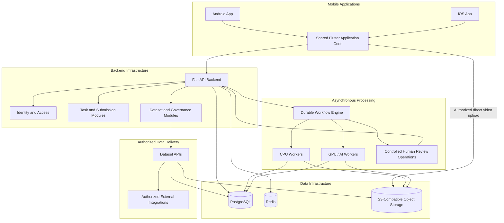

# ROBOLENS — System Architecture Document

**Document Type:** System Architecture & Technical Design
**Product:** ROBOLENS
**Tagline:** Every Action Teaches AI.
**Status:** Architecture Baseline
**Version:** 1.1
**Primary Platforms:** Android and iOS Mobile Applications Only
**Mobile Framework:** Flutter + Dart
**Backend:** Python + FastAPI
**Database:** PostgreSQL
**Architecture Style:** Modular Backend + Asynchronous Processing + Independently Scalable AI Workers

---

## 1. Executive Summary

ROBOLENS is a mobile-first robotics training data infrastructure platform that enables contributors to record real-world task demonstrations using their smartphones. The platform securely collects video recordings, processes them through AI-assisted workflows, validates their quality, and manages structured datasets for authorized robotics researchers and enterprise customers.

ROBOLENS will provide **native mobile experiences through a shared Flutter codebase for Android and iOS only**.

The product will not include a public website, web application, enterprise web portal, or web-based administration dashboard.

The backend, APIs, databases, object storage, and AI-processing infrastructure will operate behind the mobile application. Authorized external organizations may integrate with approved dataset APIs where applicable, without requiring a ROBOLENS web portal.

### 1.1 Core objectives

- Deliver a professional and reliable Android and iOS mobile experience.
- Make task discovery, recording, and submission simple for contributors.
- Support secure, resumable video uploads over unreliable mobile networks.
- Process video asynchronously without blocking mobile requests.
- Maintain traceability from original recordings to approved datasets.
- Separate AI-generated annotations from human-verified results.
- Protect contributor privacy, consent, and licensing information.
- Scale backend and AI workers independently.
- Provide reliable monitoring, backups, recovery, and security controls.

### 1.2 Architecture principles

1. **Mobile-only product:** Android and iOS are the only supported user-facing application platforms.
2. **Secure by design:** Authentication, authorization, encryption, and privacy are foundational.
3. **Modular backend:** Organize business capabilities into clear modules before considering additional services.
4. **Asynchronous processing:** Long-running media and AI jobs execute in background workers.
5. **Durable data:** PostgreSQL stores authoritative business records; object storage stores media.
6. **Idempotent operations:** Retries must not create duplicate submissions or inconsistent published results.
7. **Quality-controlled datasets:** Automated processing alone does not guarantee data correctness.
8. **Independent scaling:** API servers, CPU workers, and GPU workers can scale according to demand.
9. **Privacy-aware collection:** Consent, retention, licensing, and deletion are part of the data lifecycle.
10. **Incremental evolution:** Infrastructure complexity must be justified by measured needs.

---

## 2. Product Scope and Boundaries

### 2.1 In scope

- Android mobile application.
- iOS mobile application.
- Contributor registration and authentication.
- Task discovery and recording instructions.
- Smartphone camera-based video recording.
- Video preview, submission, and upload recovery.
- Contributor submission history and status.
- Backend APIs and business logic.
- Video storage and validation.
- AI-assisted video analysis and annotation.
- Human quality-review workflows managed through secured internal operations.
- Dataset management and versioning.
- Authorized dataset API access and integrations.
- Privacy, consent, licensing, security, monitoring, and recovery.

### 2.2 Explicitly out of scope

The following are not part of the product interface:

- Public marketing website.
- Browser-based user application.
- Browser-based enterprise portal.
- Browser-based admin dashboard.
- Browser-based contributor dashboard.
- Web-based task recording.
- Web-based video capture.
- A separate desktop application.

Internal operations must use secured backend APIs and controlled operational tooling. Any future internal user interface would require a separate architecture decision and must not be assumed to be part of the current product.

### 2.3 Important technical limitation

Ordinary smartphone RGB video does not inherently provide exact 3D robot trajectories, applied forces, tactile measurements, or robot joint states. These capabilities require additional evidence, sensors, calibration, or validated reconstruction methods where applicable.

ROBOLENS must document what each dataset actually contains and must not represent inferred values as direct sensor measurements.

---

## 3. High-Level System Architecture



This diagram describes logical responsibilities. It does not require every module to run as a separate service.

### 3.1 Major components

| Component | Responsibility |
|---|---|
| Flutter mobile application | Contributor experience on Android and iOS |
| FastAPI backend | Authentication, business rules, APIs, and coordination |
| PostgreSQL | Authoritative application and relational metadata |
| Redis | Caching, rate limiting, and temporary coordination |
| Object storage | Original videos, processed assets, and dataset artifacts |
| Workflow engine | Durable orchestration and retry handling |
| CPU workers | Media inspection and CPU-oriented processing |
| GPU workers | AI inference and GPU-intensive processing |
| Review operations | Controlled human verification and quality decisions |
| Dataset APIs | Authorized programmatic access to approved datasets |
| Observability infrastructure | Logs, metrics, traces, and alerts |

---

## 4. Technology Stack

| Layer | Technology | Purpose |
|---|---|---|
| Android and iOS | Flutter + Dart | Shared mobile application |
| Backend | Python + FastAPI | Backend APIs and business logic |
| API contracts | OpenAPI | API documentation and validation |
| Primary database | PostgreSQL | Transactional records and metadata |
| Cache and coordination | Redis | Caching and temporary coordination |
| Media storage | S3-compatible object storage | Videos and dataset artifacts |
| Workflow orchestration | Temporal | Durable long-running workflows |
| AI processing | Python + PyTorch | Model inference |
| Video processing | OpenCV + FFmpeg | Video inspection and transformations |
| Containers | Docker | Consistent execution environments |
| CI/CD | Automated build and deployment pipelines | Testing and release automation |
| Observability | OpenTelemetry-compatible tooling | Logs, metrics, and traces |

Technology versions, deployment providers, and service configurations must be pinned and validated during implementation.

### 4.1 Technology rules

- Flutter is the only planned user-facing application framework.
- Android and iOS builds must be tested independently.
- Backend business logic must not depend on a particular mobile client.
- PostgreSQL is the authoritative source for business records.
- Large binary files must be stored in object storage, not directly in relational tables.
- Redis must not be the sole location for critical durable state.
- CPU and GPU workers must scale independently of the API layer.
- External integrations must use documented, authenticated interfaces.

---

## 5. Mobile Application Architecture

### 5.1 Architecture goals

The mobile application must be responsive, accessible, reliable, secure, and easy to use on supported Android and iOS smartphones.

The shared Flutter codebase should minimize duplicated logic while allowing platform-specific implementation where camera behavior, permissions, background execution, or operating-system requirements differ.

### 5.2 Logical project structure

```text
mobile/
├── lib/
│   ├── app/
│   ├── core/
│   │   ├── networking/
│   │   ├── authentication/
│   │   ├── storage/
│   │   ├── permissions/
│   │   ├── error_handling/
│   │   └── observability/
│   ├── features/
│   │   ├── onboarding/
│   │   ├── authentication/
│   │   ├── task_discovery/
│   │   ├── task_instructions/
│   │   ├── recording/
│   │   ├── video_preview/
│   │   ├── upload_manager/
│   │   ├── submissions/
│   │   ├── contributor_profile/
│   │   └── notifications/
│   ├── shared/
│   │   ├── widgets/
│   │   ├── models/
│   │   └── utilities/
│   └── main.dart
├── test/
├── integration_test/
├── android/
└── ios/
```

This is a suggested logical structure. The final implementation should follow consistent Flutter conventions and selected state-management practices.

### 5.3 Mobile modules

**Authentication**

- Registration and login.
- Secure session management.
- Account recovery.
- Logout and session revocation.

**Task discovery**

- Available tasks.
- Eligibility requirements.
- Task instructions and recording guidelines.
- Task-specific capture requirements.

**Recording**

- Camera and microphone permissions when required.
- Task-guided recording.
- Recording duration and capture checks.
- Preview, discard, and submission controls.

**Upload manager**

- Upload session management.
- Progress reporting.
- Resumable or multipart uploads where supported.
- Retry handling.
- Interrupted-upload recovery.

**Submission history**

- Submission status.
- Processing progress.
- Rejection or correction reasons when appropriate.
- Resubmission guidance where permitted.

**Contributor profile**

- Account settings.
- Consent and applicable agreements.
- Notification preferences.
- Privacy and account-management options.

### 5.4 Recording lifecycle

1. Retrieve the task definition and capture requirements.
2. Display the instructions and relevant consent information.
3. Verify required camera and microphone permissions.
4. Record the task using the supported capture configuration.
5. Allow the contributor to preview or discard the recording.
6. Perform local checks where practical.
7. Create a submission through the backend.
8. Obtain authorized upload instructions.
9. Upload the video directly to object storage.
10. Verify upload completion with the backend.
11. Display the server-confirmed processing status.

The mobile app must not mark a submission as successfully uploaded solely because a local upload operation appeared to finish. Final status must be confirmed by the backend.

### 5.5 Offline and background behavior

- Persist necessary upload metadata locally.
- Support upload recovery after network interruptions.
- Use platform-supported background execution where available.
- Clearly indicate when connectivity is unavailable.
- Handle application termination without silently losing upload state.
- Protect locally stored media and credentials.
- Apply a documented cleanup policy to temporary files.

Unrestricted background uploads cannot be guaranteed because Android and iOS impose their own execution and resource limits.

### 5.6 State management

- Separate UI presentation from business logic.
- Use a consistent state-management strategy.
- Centralize networking and error handling.
- Represent loading, empty, offline, success, and failure states explicitly.
- Keep domain models separate from presentation widgets.
- Avoid embedding business rules directly inside UI components.

---

## 6. Backend Architecture

### 6.1 Deployment model

Begin with a modular FastAPI backend and independently scalable processing workers.

This provides clear business boundaries without requiring every module to be deployed as a separate microservice from the beginning.

### 6.2 Backend modules

**Identity and access**

- Registration and authentication integration.
- Token and session lifecycle.
- Roles and permissions.
- Account status.
- Organization membership.
- Security events.

**Task management**

- Task definitions and versions.
- Recording instructions.
- Capture requirements.
- Eligibility rules.
- Task availability and lifecycle.

**Submission management**

- Submission creation.
- Submission state transitions.
- Upload-session tracking.
- Idempotency and duplicate prevention.
- Processing initiation.
- Submission history.

**Processing orchestration**

- Workflow initiation.
- Activity tracking.
- Retry and timeout policies.
- Failure handling.
- Reprocessing operations.

**Annotation and quality management**

- Annotation records.
- Model and pipeline provenance.
- Confidence and validation metadata.
- Review decisions and corrections.

**Dataset management**

- Dataset definitions.
- Dataset versions.
- Inclusion and exclusion rules.
- Quality metadata.
- Publication and withdrawal operations.

**Governance and administration**

- Consent and license records.
- Retention and deletion workflows.
- Audit logging.
- Controlled operational actions.
- Internal support operations through authorized interfaces.

These modules are backend capabilities, not separate web applications.

### 6.3 Module boundaries

- Each module must have explicit responsibilities.
- Cross-module operations must use defined interfaces.
- Database ownership must be organized by domain.
- Authorization must be checked server-side.
- External service integrations must use controlled adapters.
- Modules should be extracted into separate services only when justified by scaling, deployment, or security requirements.

---

## 7. API Architecture

The mobile application communicates with the backend through versioned APIs.

### 7.1 API conventions

- Use REST endpoints under `/api/v1`.
- Maintain an OpenAPI specification.
- Use JSON for standard requests and responses.
- Apply request validation and authorization.
- Use pagination for large collections.
- Use consistent error formats and HTTP status codes.
- Support idempotency for retry-sensitive operations.
- Apply rate limits and request-size limits.
- Include correlation identifiers for diagnostics.

### 7.2 Proposed API groups

```text
/api/v1/auth/*
/api/v1/users/*
/api/v1/tasks/*
/api/v1/submissions/*
/api/v1/uploads/*
/api/v1/annotations/*
/api/v1/reviews/*
/api/v1/datasets/*
/api/v1/consent/*
/api/v1/account/*
```

These are proposed API groups. Exact endpoints, payloads, and permissions will be finalized in `api-specification.md`.

### 7.3 Upload lifecycle

1. The mobile app creates a submission.
2. The app requests an upload session.
3. The backend validates the request and issues short-lived upload authorization.
4. The app uploads the video directly to object storage.
5. The app requests upload completion.
6. The backend verifies the stored object and relevant integrity metadata.
7. The submission enters the appropriate processing state.
8. The workflow engine starts asynchronous processing.
9. The app retrieves the confirmed status from the backend.

The backend must verify object ownership, existence, expected size, and integrity evidence where available.

### 7.4 Dataset APIs

Authorized external customers may access approved datasets through documented APIs or controlled download mechanisms.

These are integration interfaces, not a ROBOLENS website or browser-based customer portal. Authentication, entitlements, licensing, and audit requirements must be enforced by the backend.

---

## 8. Database and Storage Architecture

### 8.1 PostgreSQL

PostgreSQL stores authoritative business records, including:

- Users and account metadata.
- Organizations and memberships where required.
- Task definitions and versions.
- Submissions and their statuses.
- Upload-session metadata.
- Consent and license records.
- Annotation metadata.
- Review decisions.
- Dataset definitions and versions.
- Access entitlements.
- Audit references.

Use transactions, schema migrations, foreign keys, unique constraints, and indexes according to the finalized database design.

### 8.2 Object storage

Use S3-compatible object storage for:

- Original video recordings.
- Validated and transformed media.
- Thumbnails and previews.
- Annotation exports.
- Dataset manifests.
- Published dataset artifacts.

Use opaque object identifiers rather than directly identifying personal information in object keys.

### 8.3 Media provenance

Preserve source recordings as immutable artifacts after acceptance, subject to applicable deletion and retention requirements.

Derived artifacts must record relevant provenance, including:

- Source artifact identifier.
- Content checksum where appropriate.
- Media properties.
- Processing pipeline version.
- Transformation metadata.
- Creation timestamp.
- Validation status.

Annotation corrections should create new revisions rather than silently erasing historical decisions.

### 8.4 Redis

Redis may support:

- Caching.
- Rate limiting.
- Temporary coordination.
- Other non-authoritative optimizations.

Critical business state must remain recoverable from durable storage.

### 8.5 Data lifecycle

Each data category must have explicit rules for collection, staging, processing, review, publication, retention, archival, and deletion.

---

## 9. Video Ingestion and Upload Reliability

### 9.1 Requirements

- Direct uploads to object storage where appropriate.
- Resumable or multipart uploads where supported.
- Short-lived and narrowly scoped upload authorization.
- Server-side integrity verification.
- Configurable media-size and duration limits.
- Expiration of abandoned upload sessions.
- Retry-safe upload completion.
- Controlled cleanup of temporary objects.

### 9.2 Illustrative state machine

```text
CREATED
   |
   v
UPLOAD_AUTHORIZED
   |
   v
UPLOADING
   |
   v
UPLOAD_VERIFICATION
   |
   v
UPLOADED
   |
   v
PROCESSING_QUEUED
   |
   v
PROCESSING
   |
   v
QUALITY_REVIEW
   |
   v
APPROVED / REJECTED
```

Failure, cancellation, and expiration states must also be supported.

### 9.3 Upload security

- Validate media content rather than trusting file extensions alone.
- Restrict upload authorization to the intended object.
- Prevent object replacement by unauthorized users.
- Limit resource consumption and concurrent uploads.
- Verify completed uploads server-side.
- Clean up incomplete multipart uploads.
- Reject malformed or unsupported media before expensive processing.

---

## 10. AI and Video Processing Architecture

### 10.1 Processing pipeline

1. Verify the uploaded media.
2. Extract media metadata.
3. Run task-specific technical quality checks.
4. Execute applicable AI models.
5. Store annotations with provenance.
6. Evaluate annotation quality.
7. Route eligible data through the applicable review policy.
8. Approve, reject, or correct annotations.
9. Make approved data eligible for dataset assembly.

### 10.2 Processing responsibilities

**Media validation**

- File readability and corruption checks.
- Duration and size validation.
- Frame dimensions and frame-rate inspection.
- Required stream validation.
- Task-specific technical requirements.

**AI annotation**

Depending on validated model capabilities:

- Action classification.
- Temporal segmentation.
- Object detection and tracking.
- Event detection.
- Structured descriptions.
- Quality scoring.

**Quality evaluation**

- Missing or invalid segments.
- Timestamp inconsistencies.
- Contradictory labels.
- Low-confidence predictions.
- Missing task steps.
- Poor visibility and obstruction.

**Human review**

- Inspect source recordings.
- Verify or correct annotations.
- Record review decisions.
- Preserve annotation history.
- Escalate disputed or low-confidence cases.

### 10.3 Annotation provenance

Each annotation should retain relevant information about its source, label, timestamps, model or annotator, pipeline version, confidence, review status, and revision history.

AI-generated labels must remain distinguishable from verified annotations.

### 10.4 Compute isolation

- CPU workers handle media inspection and CPU-oriented operations.
- GPU workers handle model inference where acceleration is beneficial.
- Workers should be stateless where practical.
- Inputs and outputs must be durably stored.
- Concurrency must respect resource limits.
- Failed activities must be safely retryable.

---

## 11. Workflow Orchestration

Use Temporal as the proposed durable workflow engine for long-running processing.

Workflows coordinate validation, metadata extraction, AI inference, quality evaluation, review routing, and dataset eligibility checks.

### Reliability requirements

- Explicit timeouts.
- Bounded retries with appropriate backoff.
- Idempotent activities.
- Durable failure state.
- Controlled cancellation and reprocessing.
- Versioned workflow changes.
- Compact workflow payloads that reference stored artifacts instead of embedding large media.

Where reliable event publication is required, use a transactional outbox or an equivalent durable handoff to coordinate database changes with workflow initiation.

---

## 12. Dataset Architecture

### 12.1 Dataset definition

A dataset is a governed collection of eligible submissions and associated artifacts.

Each dataset should define:

- Dataset identifier and version.
- Intended use and scope.
- Inclusion and exclusion criteria.
- Annotation schema version.
- Source submission references.
- Quality requirements.
- Consent and license eligibility.
- Publication status.
- Creation timestamp and change history.

### 12.2 Dataset lifecycle

```text
DRAFT
  |
  v
VALIDATION
  |
  v
READY_FOR_REVIEW
  |
  v
APPROVED
  |
  v
PUBLISHED
  |
  v
DEPRECATED / WITHDRAWN
```

Invalid or rejected datasets must not be published. Publication and withdrawal require explicit authorization and audit records.

### 12.3 Reproducibility

Record source references, annotation versions, inclusion rules, and transformation pipeline versions so dataset releases can be reconstructed where retention and licensing rules permit.

Legal or contractual deletion obligations must take precedence over immutable-history requirements.

### 12.4 Delivery

Approved datasets may be delivered through:

- Authorized API access.
- Controlled, short-lived download links.
- Programmatic enterprise integrations.

Dataset delivery must not expose private contributor information or bypass licensing and entitlement checks.

---

## 13. Security Architecture

### 13.1 Identity and authorization

Use a standards-based identity solution with secure authentication and session management.

Authorization must consider identity, account status, resource ownership, permissions, and dataset entitlements.

### 13.2 Data protection

- HTTPS for network traffic.
- Encryption at rest through managed or equivalent controls.
- Dedicated secrets management.
- Credential and signing-key rotation.
- Separate development, staging, and production credentials.
- Restricted access to production data.
- Dependency and container-image scanning.
- Least-privilege permissions.

### 13.3 Threat mitigation

Address:

- Unauthorized video access.
- Broken object-level authorization.
- Malformed media.
- Upload abuse.
- Account takeover.
- Cross-organization data leakage.
- Compromised dependencies.
- Unauthorized dataset access.
- Privileged-operation abuse.

### 13.4 Audit events

Record important authentication, permission, upload, annotation, review, dataset publication, deletion, and administrative events.

Audit logs must be protected from unauthorized modification and must not contain passwords, tokens, or unnecessary personal information.

---

## 14. Privacy, Consent, and Data Governance

Video recordings may contain faces, voices, private spaces, documents, and bystanders.

### 14.1 Consent

Explain the intended purpose, data categories, use, access conditions, retention, and licensing before collection.

Maintain versioned consent records linked to the applicable submissions.

### 14.2 Data minimization

- Collect only information needed for the task.
- Avoid unnecessary personal information in metadata.
- Provide guidance to reduce unrelated capture.
- Define procedures for accidentally captured sensitive content.
- Apply additional safeguards to higher-risk recording tasks.

### 14.3 Retention and deletion

Define lifecycle rules for original media, derived assets, annotations, logs, and published artifacts.

Deletion workflows must account for dependent artifacts, caches, exports, and downstream datasets. Backup retention must be documented accurately.

### 14.4 Legal review

Before commercial launch, obtain appropriate review of contributor agreements, licenses, privacy notices, customer contracts, and applicable data-protection requirements.

---

## 15. Infrastructure and Deployment

### 15.1 Environments

Maintain separate development, testing, staging, and production environments.

Production credentials and personal data must not be copied into development environments without explicit authorization and appropriate safeguards.

### 15.2 Containers

Use Docker for backend and processing workers.

Containers should use least privilege, pinned dependencies, controlled base images, resource limits, health checks, graceful shutdown, and structured logging.

### 15.3 CI/CD

The release pipeline should include:

1. Code review and branch protection.
2. Formatting and static analysis.
3. Unit and integration tests.
4. Security and dependency scanning.
5. Container builds.
6. Database migration validation.
7. Staging deployment.
8. Automated smoke and acceptance tests.
9. Controlled production release.
10. Post-deployment monitoring and rollback procedures.

### 15.4 Mobile release pipelines

Maintain separate Android and iOS build and release workflows.

Validate:

- Platform-specific permissions.
- Camera and media behavior.
- Secure credential handling.
- Release signing and secret management.
- App lifecycle and background-upload behavior.
- Supported operating-system versions.
- Store submission requirements.
- Crash reporting and release health.

Mobile signing credentials must never be committed to source control.

### 15.5 Infrastructure selection

Choose cloud and storage providers based on regional availability, data residency, GPU access, media throughput, backup capabilities, security, egress costs, and operational support.

---

## 16. Scalability and Performance

Scale components according to measured demand:

- API replicas for request traffic.
- CPU workers for media-processing throughput.
- GPU workers for AI inference.
- Workflow capacity for orchestration volume.
- Database resources and indexes for transactional workload.
- Object storage for media capacity and delivery.

Avoid routing entire video files through API servers when direct object-storage upload is suitable.

Use bounded worker concurrency, streaming media processing, storage lifecycle rules, and explicit upload limits.

Start with a well-indexed PostgreSQL deployment. Introduce read replicas, partitioning, or other advanced strategies only when measurements justify them.

Capacity planning must consider recording size, upload volume, processing duration, GPU requirements, database workload, dataset downloads, and retention duration.

---

## 17. Reliability and Disaster Recovery

### Failure scenarios

- Interrupted mobile uploads.
- Duplicate submission requests.
- Corrupted media.
- Storage-provider outages.
- Worker crashes.
- AI inference errors.
- Workflow timeouts.
- Database connectivity failures.
- Expired upload authorization.
- Review delays.
- Failed dataset publication.
- Accidental data deletion.

### Recovery requirements

- Retry transient failures safely.
- Avoid retrying permanent validation failures indefinitely.
- Preserve recoverable processing state.
- Use idempotency and database constraints.
- Isolate repeatedly failing jobs.
- Provide authorized operational recovery procedures.
- Verify object integrity before accepting recovered uploads.
- Maintain tested database and artifact-recovery procedures.

Define explicit recovery point objectives (RPO) and recovery time objectives (RTO) before production launch. Regularly test restoration procedures.

---

## 18. Observability

### Logging

Use structured logs with timestamps, environment, service identity, severity, correlation identifiers, and relevant submission or workflow identifiers.

Do not log sensitive media, credentials, or unnecessary personal information.

### Metrics

Monitor:

- API latency and errors.
- Authentication failures.
- Upload completion and failure rates.
- Processing backlog.
- Workflow duration and retry count.
- CPU/GPU worker utilization.
- Annotation and review turnaround time.
- Dataset publication failures.
- Storage growth and infrastructure costs.
- Android and iOS crash rates.

### Tracing and alerts

Use OpenTelemetry-compatible tooling where appropriate to trace API requests and processing activities.

Set actionable alerts for service outages, repeated worker failures, growing backlogs, storage risks, database saturation, and unusual access patterns.

---

## 19. Testing Strategy

### Mobile testing

- Android and iOS recording behavior.
- Camera and microphone permission denial.
- Backgrounding and application termination.
- Low-storage conditions.
- Unstable network connections.
- Upload resumption.
- Authentication expiration.
- Device compatibility.
- Accessibility and responsive layouts.

### Backend testing

- Unit tests for business rules.
- API integration tests.
- Database migration tests.
- Object-storage authorization tests.
- Workflow retry and recovery tests.
- Cross-user and cross-organization access tests.

### AI testing

Evaluate model quality against representative, appropriately labeled datasets. Measure task-specific error rates, calibration, reviewer disagreement, and failure modes.

### Resilience testing

Test concurrent uploads, large media, worker saturation, dependency outages, retry storms, database load, and interrupted processing.

---

## 20. Initial Service-Level Objectives

These are proposed targets requiring validation, not claims about existing performance.

| Area | Proposed objective |
|---|---|
| API availability | 99.9% monthly target after production stabilization |
| Lightweight API latency | p95 below 300 ms for selected endpoints under a defined workload |
| Upload integrity | All accepted uploads pass server-side verification |
| Processing reliability | Retries do not create duplicate published outputs |
| Data security | No unauthorized cross-user or cross-organization access |
| Recovery | Explicit, tested RPO and RTO |
| AI quality | Dataset-specific acceptance thresholds |
| Observability | Critical services and workflows have actionable monitoring |
| Mobile stability | Crash-rate targets defined and measured separately for Android and iOS |

Video-processing duration must have separate targets based on media characteristics and model requirements.

---

## 21. Architecture Decisions

### ADR-001: Android and iOS only

**Decision:** Build the user-facing product exclusively for Android and iOS.

**Reason:** The product's core user journey is smartphone-based recording and contribution.

**Consequence:** No public website, web app, browser-based enterprise portal, or web-based admin dashboard is included in this architecture.

### ADR-002: Flutter

**Decision:** Use Flutter and Dart for mobile development.

**Reason:** A shared codebase supports consistent Android and iOS experiences.

**Trade-off:** Platform-specific camera behavior, permissions, and background execution still require independent testing.

### ADR-003: FastAPI

**Decision:** Use Python and FastAPI for the backend.

**Reason:** Python integrates naturally with the AI and video-processing stack.

**Trade-off:** Long-running processing must run outside API request handlers.

### ADR-004: PostgreSQL

**Decision:** Use PostgreSQL for authoritative business data.

**Reason:** Transactional integrity and relational constraints are important for submissions, permissions, consent, and dataset versioning.

### ADR-005: Object storage

**Decision:** Use S3-compatible object storage for video and dataset assets.

**Reason:** It separates large-media capacity from application compute.

### ADR-006: Modular backend

**Decision:** Start with a modular backend and independently scalable processing workers.

**Reason:** This avoids premature microservice complexity while preserving clear module boundaries.

### ADR-007: Durable workflow orchestration

**Decision:** Use Temporal, subject to operational and cost validation.

**Reason:** Long-running media and AI workflows require durable state, retries, timeouts, and recovery.

### ADR-008: Verified data quality

**Decision:** Preserve the distinction between AI-generated and human-verified annotations.

**Reason:** Model confidence alone does not establish correctness or robotics suitability.

---

## 22. Implementation Sequence

### Phase 1 — Foundation

- Configure the Flutter project for Android and iOS.
- Establish the FastAPI backend.
- Configure PostgreSQL and object storage.
- Set up development environments, CI, and testing.
- Implement authentication foundations.

### Phase 2 — Mobile task lifecycle

- Implement onboarding and contributor authentication.
- Implement task discovery and instructions.
- Implement recording and preview.
- Implement submission creation and status tracking.

### Phase 3 — Secure upload

- Implement upload authorization.
- Add resumable or multipart upload support where available.
- Verify completed uploads.
- Add retry, expiration, and cleanup handling.

### Phase 4 — Processing workflows

- Configure durable workflows.
- Implement media validation and metadata extraction.
- Add CPU workers.
- Add processing status and operational monitoring.

### Phase 5 — AI and quality review

- Add selected AI models and versioned pipelines.
- Implement annotation provenance.
- Implement quality checks and review operations.
- Validate acceptance policies.

### Phase 6 — Dataset delivery

- Implement dataset definitions and versioning.
- Enforce consent, licensing, and access controls.
- Implement authorized dataset APIs and download mechanisms.
- Add publication, withdrawal, and audit workflows.

### Phase 7 — Production readiness

- Complete Android and iOS testing.
- Perform security and load testing.
- Establish monitoring and alerting.
- Validate backups and recovery.
- Complete privacy, legal, and contractual reviews.

---

## 23. Architecture Governance

Maintain this document as an active engineering reference.

Significant changes to core technologies, security boundaries, data lifecycle, workflow architecture, or deployment topology must document:

1. The problem being addressed.
2. The proposed decision.
3. Alternatives considered.
4. Security and privacy implications.
5. Migration and rollback strategy.
6. Cost and scaling implications.
7. Required validation tests.

Keep database schemas, API contracts, workflow definitions, and implementation documentation consistent with the actual system.

---

## 24. Definition of Architecture Readiness

The architecture is ready to guide implementation when:

- Android and iOS are the only defined user-facing platforms.
- No web product interface is included in scope.
- Every backend module has a defined responsibility.
- The mobile-to-storage-to-processing lifecycle is documented.
- Authentication and authorization boundaries are explicit.
- Data ownership, consent, licensing, and retention are addressed.
- AI annotations have provenance and quality controls.
- Dataset publication and API access are governed.
- Failure recovery and idempotency are designed.
- Mobile testing covers Android and iOS separately.
- Monitoring, backups, and recovery requirements are defined.
- Outstanding technical decisions have explicit validation tasks.

## 25. Final Architecture Statement

ROBOLENS will be a mobile-only robotics training data platform delivered through Android and iOS applications built with Flutter.

A secure Python/FastAPI backend, PostgreSQL database, object storage, durable workflows, and independently scalable AI workers will support mobile task participation, video ingestion, AI-assisted processing, quality verification, and governed dataset delivery.

The platform will preserve the relationship between original recordings, annotations, human verification, consent, dataset versions, and authorized data distribution.

The architecture deliberately excludes public websites, browser-based product applications, enterprise web portals, and web-based administrative dashboards.

**Core engineering principle: Collect responsibly. Process reliably. Validate rigorously. Deliver with provenance.**
