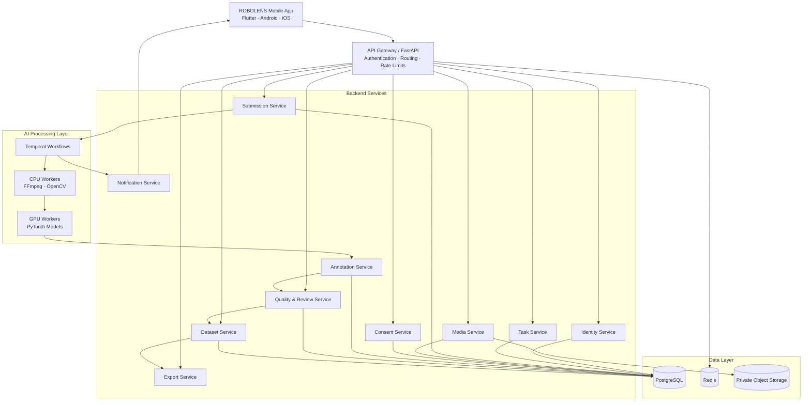
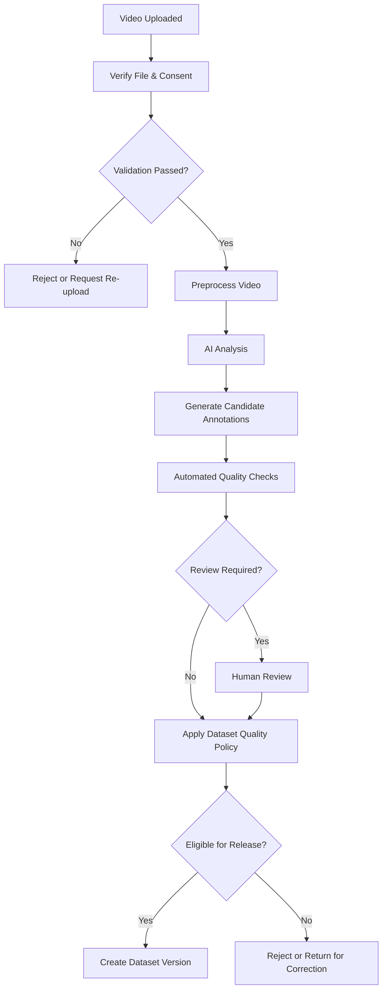

# ROBOLENS — System Design

> **Tagline:** Every Action Teaches AI.
> **Purpose:** Design a secure, scalable, mobile-first platform that transforms human task demonstrations into high-quality robotics training datasets.

## 1. System Overview

ROBOLENS collects task videos through Android and iOS apps, processes them using AI, validates annotations, and organizes approved data into versioned datasets.

**Core principles**
- Mobile-first: Flutter for Android and iOS only.
- Independent scaling for compute-intensive AI workers.
- Secure data collection with explicit consent.
- Reliable processing with retries and workflow tracking.
- Traceable annotations and reproducible dataset versions.
- Start simple; introduce complexity only when necessary.

**Out of scope:** Public website, browser-based application, enterprise web portal, and web-based admin dashboard.

## 2. High-Level Architecture

*The diagram shows logical components. Not every component needs a separate deployment on day one.*

## 3. Technology Stack

| Layer | Technology |
|---|---|
| Mobile application | Flutter + Dart |
| API and backend | Python + FastAPI |
| Primary database | PostgreSQL |
| Cache and rate limiting | Redis |
| Durable workflow orchestration | Temporal |
| Video processing | FFmpeg + OpenCV |
| AI inference | PyTorch + CPU/GPU workers |
| Media storage | S3-compatible object storage |
| Containers | Docker |
| CI/CD | GitHub Actions |
| Monitoring | OpenTelemetry + Prometheus/Grafana-compatible tools |

Use compatible, supported versions and pin dependencies during implementation.

## 4. Microservices Responsibilities

| Service | Responsibility |
|---|---|
| Identity | Accounts, authentication, sessions, roles |
| User | Profiles and contributor preferences |
| Task | Recording instructions, task availability, eligibility |
| Submission | Submission lifecycle and status |
| Media | Upload sessions, file validation, media metadata |
| Consent | Permissions, licenses, retention rules |
| Processing | Workflow coordination and job status |
| Annotation | AI labels, timestamps, provenance, corrections |
| Quality & Review | Automated checks, human review, decisions |
| Dataset | Dataset membership, versions, release metadata |
| Export | Authorized dataset exports and download access |
| Organization | Enterprise memberships and permissions |
| Notification | Push notifications and processing updates |

Each service owns its business rules and data. Other services must not directly modify its private database tables.

## 5. Mobile Application Experience

The app should provide four clear primary experiences:

1. **Home:** Recommended tasks, ongoing submissions, and account status.
2. **Explore Tasks:** Instructions, eligibility, estimated duration, and applicable rewards where offered.
3. **Record & Upload:** Guided camera capture, validation checks, upload progress, and safe retries.
4. **My Submissions:** Processing status, review feedback, and available actions.

Additional screens include profile, consent settings, notifications, support, and authorized dataset access where applicable.

**User experience requirements**
- Clear language and accessible controls.
- Resumable uploads where supported.
- Helpful errors with actionable recovery steps.
- Low-bandwidth resilience and safe retry behavior.
- Explicit recording permissions and consent.
- No misleading processing percentages or approval promises.

## 6. Video Processing Pipeline

### Processing rules

- Keep the original video immutable.
- Verify file integrity, format, duration, and configured limits.
- Record model versions and processing configuration.
- Preserve AI-generated predictions separately from human-verified annotations.
- Track quality results, review decisions, and corrections.
- Retry transient failures without duplicating submissions or dataset entries.
- Release data only when quality, consent, and licensing requirements are satisfied.

**Physical AI limitation:** Smartphone RGB video alone does not provide exact robot joint states, force readings, tactile measurements, or guaranteed ground-truth 3D trajectories. Such signals require suitable sensors or validated estimation methods.

## 7. Database & Storage Design

**PostgreSQL stores**
- Users, organizations, tasks, and submissions.
- Upload metadata and processing states.
- Consent records and licenses.
- Annotation records and review decisions.
- Dataset versions, memberships, and audit metadata.

**Object storage stores**
- Original videos.
- Extracted frames and derived processing artifacts.
- Approved dataset files and manifests.

**Redis handles**
- Cache, rate limits, and temporary coordination.

Redis must not be the only durable record of submissions, workflow progress, or dataset releases.

Use database migrations, foreign keys, appropriate indexes, transaction boundaries, and uniqueness constraints.

## 8. Service Communication

Use two communication patterns:

- **REST APIs:** Login, task discovery, profile updates, submission creation, and status retrieval.
- **Durable workflows and asynchronous events:** Video processing, quality checks, notifications, and dataset generation.

Temporal coordinates long-running workflows. Add a dedicated message broker only when independent event streaming or throughput requirements justify it.

**Reliability rules**
- Apply request timeouts.
- Retry transient failures with bounded exponential backoff.
- Make operations idempotent where possible.
- Assume events can be duplicated or arrive out of order.
- Validate state transitions before applying changes.
- Use reliable event publishing patterns, such as a transactional outbox, when database changes must trigger events.

## 9. Security & Privacy

- Use secure password hashing and revocable authentication tokens.
- Enforce authorization in the backend, not just in the app.
- Encrypt data in transit and at rest.
- Keep object storage private and use short-lived access URLs.
- Protect secrets outside source control.
- Obtain explicit consent and enforce permitted data usage.
- Restrict reviewer, administrator, and enterprise permissions.
- Maintain audit logs for sensitive access and dataset exports.
- Define retention, deletion, backup, and incident-response procedures.
- Never expose credentials, private storage paths, or unnecessary personal information in logs.

## 10. Scalability & Reliability

Scale components according to measured demand:

- **API:** Add backend instances behind a load balancer.
- **Database:** Optimize queries and indexes before adding replicas.
- **Video processing:** Scale CPU workers independently.
- **AI inference:** Scale GPU workers according to model demand.
- **Storage:** Use object storage lifecycle and retention policies.
- **Workflows:** Tune worker concurrency and queue capacity.

Implement health checks, structured logs, metrics, distributed tracing, alerts, backups, and tested recovery procedures.

Avoid premature sharding, excessive microservices, and unnecessary infrastructure.

## 11. Deployment Architecture

Maintain separate development, staging, and production environments.

- Docker Compose for local development.
- Automated testing and security checks in CI/CD.
- Versioned container images and controlled deployments.
- Reviewed database migrations.
- Smoke tests before production release.
- Rollback procedures for application deployments.
- Automated backups and periodic restoration tests.

Select cloud hosting and deployment infrastructure based on budget, availability requirements, regional needs, and measured workloads.

## 12. Recommended Implementation Phases

**Phase 1 — Core Platform**
- Flutter application foundation.
- Identity, task, submission, and media modules.
- PostgreSQL and private object storage.
- Reliable video upload and status tracking.

**Phase 2 — AI Processing**
- Temporal workflows.
- CPU/GPU worker infrastructure.
- Annotation generation and provenance.
- Automated quality checks.

**Phase 3 — Review & Datasets**
- Human-review workflows.
- Consent and license enforcement.
- Dataset versioning and manifests.
- Authorized export APIs.

**Phase 4 — Production Scale**
- Independent service deployments where justified.
- Organization access controls.
- Monitoring, security testing, disaster recovery.
- Load testing and cost optimization.

## 13. Definition of Done

The system design is ready for implementation when:

- Every service has clear ownership and API contracts.
- Database relationships and migrations are defined.
- Uploads can recover safely from interruptions.
- Processing jobs can retry without duplicating results.
- AI and human annotations remain distinguishable.
- Consent and authorization are enforced end-to-end.
- Dataset versions are traceable and reproducible.
- Monitoring, backups, and recovery procedures are tested.

**Final principle:** Build a mobile-first, modular, secure system that can evolve into independently scalable microservices without making the initial product unnecessarily complex.
