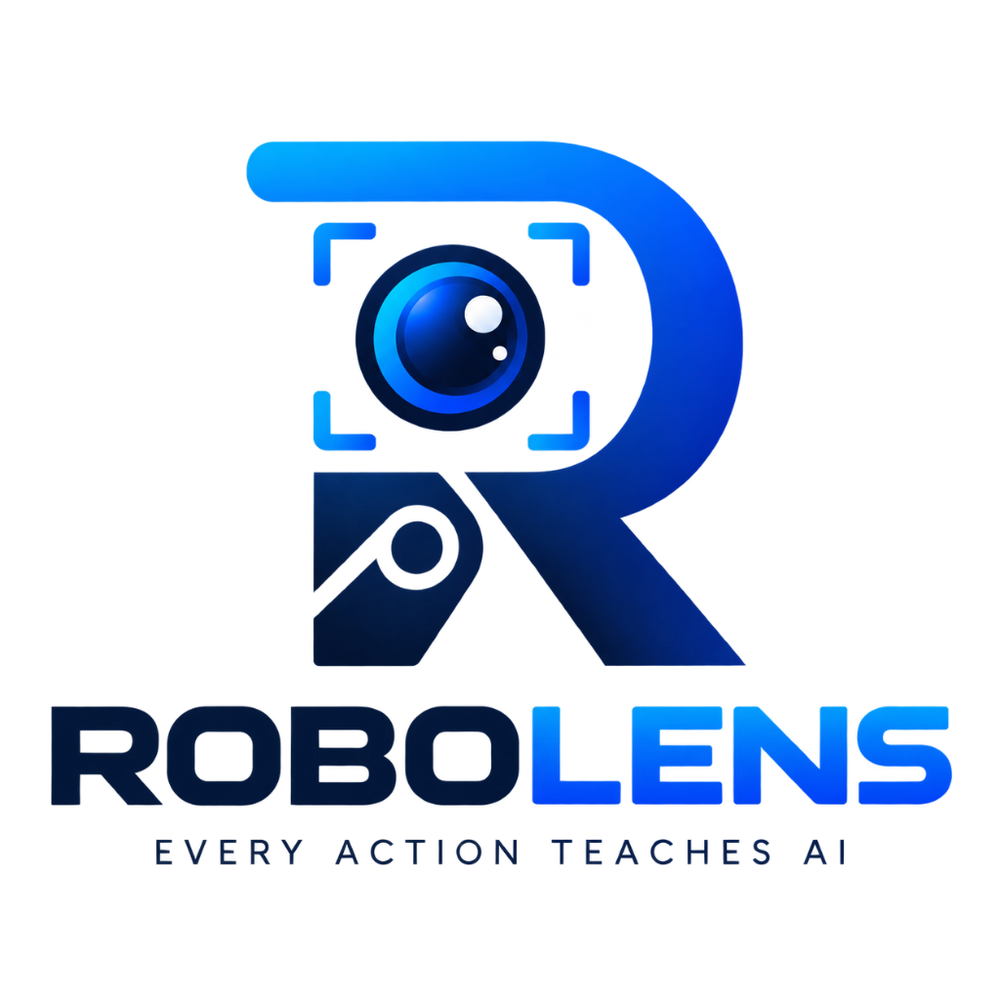
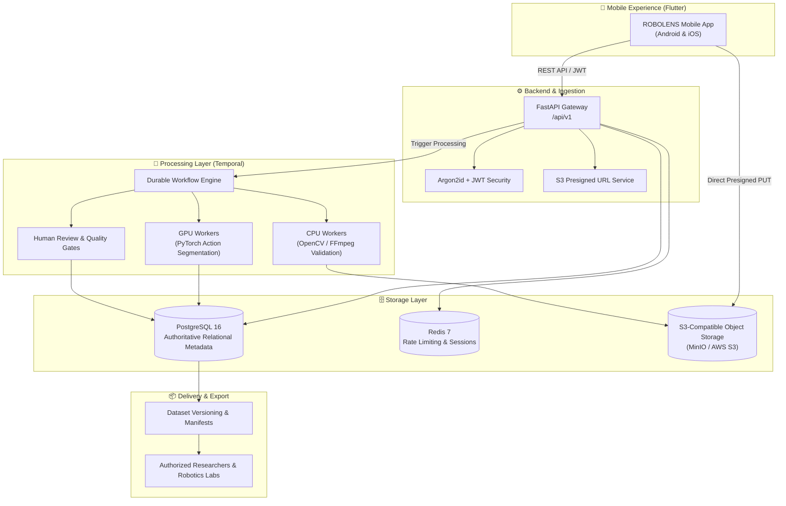

<p align="center">
  
</p>

<h1 align="center">ROBOLENS</h1>

<p align="center">
  <strong>Every Action Teaches AI.</strong><br>
  <em>A Smartphone-Powered Robotics Training Data & Physical AI Infrastructure Platform</em>
</p>

<p align="center">
  <a href="https://github.com/indrajitkumar23541-a11y/ROBOLENS"></a>
  <a href="https://github.com/indrajitkumar23541-a11y/ROBOLENS"></a>
  <a href="https://github.com/indrajitkumar23541-a11y/ROBOLENS"></a>
  <a href="https://github.com/indrajitkumar23541-a11y/ROBOLENS"></a>
  <a href="https://github.com/indrajitkumar23541-a11y/ROBOLENS"></a>
  <a href="https://github.com/indrajitkumar23541-a11y/ROBOLENS"></a>
  <a href="https://github.com/indrajitkumar23541-a11y/ROBOLENS/blob/main/LICENSE"></a>
</p>

---

## 📌 Overview

**ROBOLENS** is a production-grade data collection and transformation infrastructure that enables contributors to record real-world manipulation tasks using their smartphones. Behind the contributor mobile application, ROBOLENS runs an asynchronous, AI-assisted video understanding and quality-verification engine that structures, validates, and packages demonstration recordings into training datasets for robotics research and **Physical AI** models.

> **Architecture Principle:** Mobile-first contributor experience on Android and iOS. Video data is uploaded directly to private object storage, decoupled from API gateways, and processed asynchronously via durable workflows.

---

## 🌟 Key Features

| Capability | Technical Realization |
|---|---|
| **📱 Mobile-First Capture** | Shared Flutter codebase targeting Android & iOS with custom viewfinder, framing guides, and offline resilience. |
| **⚡ Direct-to-S3 Uploads** | Bypasses backend API gateways using short-lived presigned PUT URLs, multipart chunks, and streaming progress callbacks. |
| **🛡️ Asynchronous Durability** | Built with **Temporal** durable workflow orchestration to guarantee fault-tolerant, idempotent media pipelines with automatic retry backoff. |
| **🤖 AI Action Segmentation** | Computer vision & PyTorch workers identify temporal boundaries (e.g. `reach`, `grasp`, `transport`, `place`) with confidence scores. |
| **🔍 Provenance & Transparency** | Explicit separation between `AI_GENERATED` candidate labels and `HUMAN_VERIFIED` review results. Full audit history is maintained. |
| **📦 Robotics-Ready Formats** | Generates versioned, immutable datasets compatible with downstream robotics frameworks such as **LeRobot** and **RLDS**. |

---

## 🏗️ System Architecture



---

## 🛠️ Technology Stack

- **Mobile Client:** Flutter + Dart (Android & iOS native compilation)
- **API Framework:** Python 3.10+, FastAPI, Pydantic v2
- **ORM & Migrations:** SQLAlchemy 2.0, Alembic
- **Primary Database:** PostgreSQL 16
- **Caching & Rate Limiting:** Redis 7
- **Object Storage:** MinIO (Local) / AWS S3 (Production)
- **Workflow Orchestration:** Temporal
- **Computer Vision & AI:** OpenCV, FFmpeg, PyTorch
- **Containerization:** Docker, Docker Compose
- **Testing:** Pytest (with in-memory test isolation)

---

## 📂 Project Organization

```text
ROBOLENS/
├── assets/                     # Branding assets & logos
│   └── logo.png
│
├── Docs/                       # System architecture, PRD, and engineering specifications
│   ├── Architecture/           # System Architecture & Service Communication
│   ├── Backend/                # Database Schema & API Specifications
│   ├── Processing/             # Video & AI Processing Pipeline
│   ├── Infrastructure/         # Deployment Architecture & Scaling
│   ├── Security/               # Privacy, Consent, and Security Baseline
│   └── PRD.md                  # Comprehensive Product Requirements Document
│
├── infra/                      # Infrastructure as Code
│   ├── docker-compose.yml      # PostgreSQL 16, Redis 7, MinIO, Temporal
│   └── .env.example            # Environment variables template
│
├── backend/                    # Python + FastAPI Backend
│   ├── app/
│   │   ├── api/v1/             # Endpoints (/auth, /tasks, /submissions, /datasets, /health)
│   │   ├── core/               # App configuration, security (Argon2id + JWT), database sessions
│   │   ├── models/             # SQLAlchemy ORM models (13 tables)
│   │   ├── schemas/            # Pydantic validation schemas
│   │   ├── services/           # S3 client, presigned URL generators, checksum verifiers
│   │   └── main.py             # FastAPI entrypoint & middleware
│   ├── alembic/                # Database migration scripts (001_initial_schema.py)
│   ├── tests/                  # Automated integration & unit tests
│   └── requirements.txt        # Backend dependencies
│
├── workers/                    # Asynchronous Processing Workers
│   ├── activities/             # OpenCV validation, PyTorch AI annotation, Quality scoring
│   ├── workflows/              # Temporal workflow pipelines
│   └── requirements.txt        # Worker dependencies
│
└── mobile/                     # Flutter Mobile Application
    ├── lib/
    │   ├── core/               # Networking, secure token storage, API routes
    │   ├── features/           # Explore Tasks, Viewfinder Recording, Submissions, Profile
    │   └── main.dart           # Flutter 4-Tab Contributor Experience UI
    └── pubspec.yaml            # Mobile dependencies (camera, dio, secure_storage)
```

---

## ⚡ Getting Started

### 1. Prerequisites
- [Docker Desktop](https://www.docker.com/products/docker-desktop/) installed & running
- [Python 3.10+](https://www.python.org/)
- [Git](https://git-scm.com/)

### 2. Start Local Infrastructure
Launch the backing data services with one command:
```bash
docker compose -f infra/docker-compose.yml up -d
```
This automatically boots and provisions:
- **PostgreSQL 16** (`localhost:5432`)
- **Redis 7** (`localhost:6379`)
- **MinIO S3** (`localhost:9000` — Web Console at `localhost:9001`, user: `minioadmin`, pass: `minioadmin`)
  - Automatically initializes buckets: `robolens-raw-media`, `robolens-processed-media`, `robolens-datasets`
- **Temporal Server** (`localhost:7233` — Web UI at `localhost:8233`)

### 3. Run Backend API
```bash
# Activate virtual environment
.venv\Scripts\activate          # Windows PowerShell
# source .venv/bin/activate     # macOS / Linux

# Install dependencies (if not already done)
pip install -r backend/requirements.txt

# Start FastAPI server
uvicorn app.main:app --app-dir backend --reload --port 8000
```
Open **http://localhost:8000/api/v1/docs** in your browser to view the interactive OpenAPI / Swagger documentation.

### 4. Run Test Suite
```bash
python -m pytest -c backend/pytest.ini backend/tests -v
```
All tests run with isolated in-memory test databases and zero external dependencies.

---

## 📡 REST API Reference (`/api/v1`)

| Method | Endpoint | Description |
|---|---|---|
| `POST` | `/api/v1/auth/register` | Register a new contributor account |
| `POST` | `/api/v1/auth/login` | Authenticate and obtain JWT access & refresh tokens |
| `POST` | `/api/v1/auth/refresh` | Renew an expired access token |
| `GET` | `/api/v1/auth/users/me` | Fetch authenticated user profile |
| `GET` | `/api/v1/tasks` | Browse available robotics recording tasks |
| `GET` | `/api/v1/tasks/{id}/eligibility` | Verify task eligibility and remaining quota |
| `POST` | `/api/v1/submissions` | Create task episode submission with verified consent |
| `POST` | `/api/v1/submissions/{id}/uploads` | Generate short-lived presigned S3 PUT URL |
| `POST` | `/api/v1/submissions/uploads/{id}/complete` | Verify upload integrity & queue processing |
| `GET` | `/api/v1/datasets` | List approved robotics datasets |
| `POST` | `/api/v1/datasets/{id}/exports` | Request LeRobot/RLDS formatted export download |
| `GET` | `/api/v1/health` | Diagnostic health probe (DB, Redis, S3) |

---

## ⚠️ Physical AI Reality & Limitations

Ordinary smartphone RGB video does not inherently capture exact **3D robot trajectories**, **applied forces**, **tactile feedback**, or **joint states**. 

ROBOLENS explicitly differentiates between:
1. **Directly Observed:** Visual pixels, temporal timestamps, frame rates.
2. **AI-Inferred:** Action intervals, bounding boxes, hand-object interactions (`AI_GENERATED`).
3. **Human-Verified:** Quality-reviewed and corrected annotations (`HUMAN_VERIFIED`).

Datasets indicate which signals are measured versus estimated to maintain absolute scientific integrity for robotics research.

---

## 👨‍💻 Author & Project Lead

- **Indrajit Kumar** ([@indrajitkumar23541-a11y](https://github.com/indrajitkumar23541-a11y))
- **Email:** [indrajitkumar23541@gmail.com](mailto:indrajitkumar23541@gmail.com)

---

## 📄 License

This project is licensed under the MIT License - see the [LICENSE](LICENSE) file for details.
